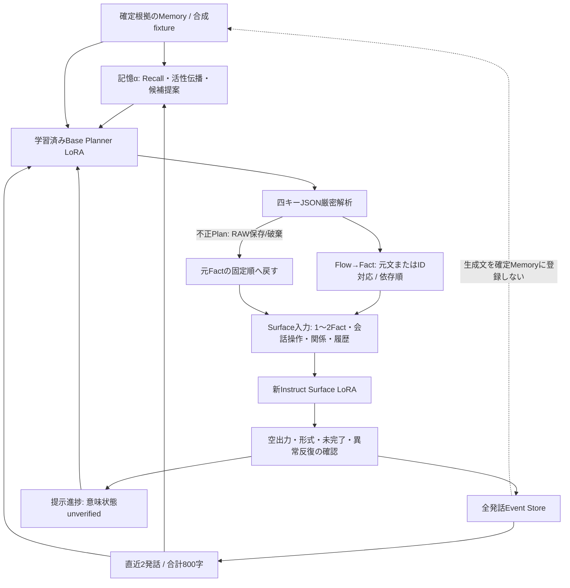

# 現行アーキテクチャ全体（2026-10-25、v5）

## モジュールと責務

|部分|現行実装|動作と範囲|
|---|---|---|
|記憶α|`runtime/vendor/alpha.py`|固定TF-IDF文字2〜4gram、タグ、1-hopリンクの順位融合。活性減衰0.77、最大8件Working Set。未完了Memoryは維持。E5は今回未使用。|
|連続運転|`runtime/run_cpu.py`, `continuous_policy.py`|20件の合成Memory94Factを候補にし、実生成本文からαへcue。種は「手袋 忘れ物」、支持候補なしの場合のみ広いcueを1回使う。事前の固定話題順ではない。|
|Planner入力|`continuous_policy.make_planner_request`, `_talk/lora_v4_gemma_runtime/context_runtime.py`|元Memory1件、実際の直近本文、前回Plan、提示進捗・未提示Fact ID。発話ごとに再判断を要求する。|
|Planner推論|`_talk/lora_v4_gemma_runtime/inference_v5.py`, `schema_constraints.py`|既存Gemma Base Planner LoRA、greedy、context2048、最大新規256token。四キーuse_memory/memory_id/topic/flow、Flow2〜4。JSON形式適合は意味妥当性と別。|
|不正Planの扱い|`runtime/planner_delivery.py`|strict parserの失敗を記録し、Plan=Noneで固定順へ継続。モデルの品質リトライはしない。|
|Planの適用|`runtime/flow_apply.py`, `fact_contract.json`|弱い文字類似度は使わない。明示IDか一意な元文spanで対応し、依存順を守る。曖昧/未対応は元Fact順へ戻る。現行sidecar対象はF01/F08/F13のみ。|
|進捗|`runtime/runtime.py:Progress`|各Factの提示は1度。presented/text_deliveredは意味確認済みではない。対象外Factを消化しない。|
|Surface契約|`runtime/contract_runtime.py`, `runtime.surface_case`|1〜2Fact（契約として1〜6対応）、会話操作、話題関係、展開、直近履歴。元Factの順・否定・時点・決定と実行を保持する指示。|
|Surface推論|`runtime/gpu_worker.py`|新Instruct LoRA（新教材61学習組/1epoch/8更新）、公式Processorのchat/prefix、公式終了token、最大384。出力本文を手で編集しない。|
|採用と履歴|`runtime/runtime.py:format_failure/EventStore`|空・未完了・形式崩壊・極端な反復だけを形式保留。通常の表現反復は記録のみ。テキスト採用は意味合格ではない。全履歴を保存し入力窓は直近2発話800字。|
|プロセスとGPU|`runtime/driver_cpu.py`, `gpu_worker.py`, `request_protocol.py`, `_talk/lora_v4_multibase/*`|CPU controller/GPU workerを分離、PID/create_timeとnative/launcher/Python receipt、全token journal、adapter実tensor照合。1枚GPUでモデルを切替。|
|事後評価|`runtime/observe_cpu.py`, `finalize_cpu.py`|正常終了と整合監査後に全文を設計者AIが確認。CPU合格は意味品質合格ではない。失敗runは別の部分監査として扱う。|

## 現行の方針

- Semantic Guard、Plan意味検査、実TTS、本番配備、生成文のMemory登録は現行経路にない。過去部品のコードが参照階層に残っていても、現行で呼んだことにはならない。
- Memory/linksは不変。αのsessions/audit/activationと発話Event Store・提示進捗だけ更新する。
- `use_memory=false`や対応不能では元Fact順を保持する。不正JSONは`planner_delivery.resolve`でRAWを保全しPlanを破棄、元Fact順で継続する。構文が正しく意味が壊れたPlanを品質合格としない。
- 長尺上限は55Surface＋55Planner。目標2500非空白字、250字/分仮定で約10分。支持候補/素材が尽きれば短くても停止し、水増ししない。
- 説明上の例・Gold Plan・設計者期待を、学習済みPlannerの判断成果に数えない。

αのRecall/関連付けは候補選択の仕組みであり、本人の実体験の真実性や自然な接続を保証しない。生成した疑問や言い換えによる自発的関心の変更、人間らしさの一般的向上は未確認。

## 保存した実行条件の違い

標準Runtimeは20合成Memory・約10分相当の継続run。人間原文比較は同じコード/モデルに4件の既存逆算Memoryとイベントcueを与え、最大5発話で一巡する別条件。差分ソースは`experiments/human_memory_compare/`のoverlayとして保存。元原文/style/Flowはモデル入力に使わない。人間原文比較では9件が複合項目で、1項目=1原子的事実ではない。
