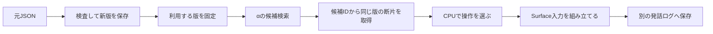

# 記憶DBとCPU接続

既存DBを保全したまま使う、独立したSQLiteの記憶入れ物。入力JSONを失わず保存し、「何への反応・評価か」をCPU選択器へ渡す。モデル推論・学習・配備はこのモジュールでは行わない。



## 保存する情報

|情報|扱い|
|---|---|
|エピソード・F/W/R/T/Q/P|元JSONと断片を両方保存。Fが0件でも希望の記憶を扱える|
|元記憶／創作補完・原文根拠・参考資料|断片の由来を保存。参考資料を出来事の証拠に転用しない|
|確かさ・実行状態|元の文字列と共通コードを両方保持。不明を実行済みにしない|
|反応・評価・疑問と答え|明示されたID参照を型付きリンクにする。意味は未確認のまま|
|説明前提・出来事の時系列|意味の関連と分離。強い語順制約には明示requires_contextだけを使う|
|訂正・承認|訂正は新版。承認は版とhashを指定。旧承認を新版へ持ち越さない|
|固定snapshot|その時点の版・review・graph・投影版を保存し、検索からSurfaceまで共有|
|発話ログ|別SQLite。使った版・断片・操作・本文を保存。生成文をMemoryへ追加しない|

## ファイル

- `normalize.py`：入力検査と控えめな共通コード化。元フィールドは残す。
- `schema.sql` / `store.py`：取込・訂正・根拠・review・snapshot。取込はエピソード単位のtransaction。同一内容の再取込は変更なし。
- `projection.py`：α用の互換JSONと、候補から同じsnapshotの記憶を取り出す接続。参考世界の記憶は本人の発話材料にしない。
- `selector_adapter.py`：旧H06と新rhythmを別経路で呼ぶ。新rhythmは明示リンクを弱い優先・接続根拠として使い、最大同色3を維持。不足は明示保留。
- `surface.py`：namespace・創作世界・由来・確実性・状態・短い表現候補を含む新接続用入力。空計画は発話依頼しない。既定Surfaceプロンプトは変更していない。
- `events.py`：固定snapshotを持つ再開可能な発話ログ。採用本文のみ直近2発話／800字窓へ戻す。すべて意味未確認。
- `run_validation.py`：凍結30件の往復・選択・検索・公式Processor入力検査と比較HTML作成。

## 使い方

リポジトリ直下で、指定Pythonを使う。以下の`python`は環境に合った実行ファイルへ置き換える。DBと出力は明示し、既存の旧DBを指定しない。

```powershell
python -X utf8 -B -m v5.memory_db --db C:/path/to/new_memory.sqlite init
python -X utf8 -B -m v5.memory_db --db C:/path/to/new_memory.sqlite import --input C:/path/to/records --namespace zip_fiction --world-scope fictional
python -X utf8 -B -m v5.memory_db --db C:/path/to/new_memory.sqlite snapshot --namespace zip_fiction --validation --output C:/path/to/validation_snapshot.json
python -X utf8 -B -m unittest v5.memory_db.tests.test_memory_db -v
```

通常snapshotは最新の内容確認済み版だけ。`--validation`は未確認も含める検証専用で、通常承認の代わりにはならない。ディレクトリ取込は各エピソードが独立transactionであり、全ファイル一括transactionではない。再実行は同一内容を重複させない。

```python
from v5.memory_db import MemoryDB
from v5.memory_db.projection import project_episode, alpha_records, resolve_recall
from v5.memory_db.selector_adapter import select_episode
from v5.memory_db.events import EventLog

with MemoryDB('new_memory.sqlite', create=False) as db:
    snapshot = db.load_snapshot(snapshot_id)
    # alpha_records(snapshot)を別のα DBへ投影。既存α DBへのforce=Trueは禁止。
    sample = resolve_recall(snapshot, alpha_candidate)
    plan = select_episode(sample, backend='rhythm')
    if plan['steps']:
        with EventLog('new_session.sqlite', snapshot) as log:
            seq, surface = log.record_input(sample['provenance']['revision_id'], plan)
            # 実際にモデルを呼ぶのは外側のハーネス。ここは入力作成のみ。
            # log.record_output(seq, actual_text, delivered=True)
```

取込形式は`talk_memory_input_draft.v1`。任意の旧DBの自動移行はしない。未知の共通コードや参照切れは失敗し、自由記述で対応不明な状態はunknownとして残す。

## 今回の検証と限界

対象は保存済み30記憶（内容確認済み8／修正待ち2／未確認20）と追加の夏祭り構造fixture。通常snapshotと検証snapshotを分ける。テスト結果は別runの`technical_audit.json`・`test_results.txt`・`result.md`に保存する。

新rhythmでは元コードをvendor保存し、別ファイルに2か所の接続hookを追加。元実験の日本語前提推定や調整済み順位重みは使わず、一般prior＋明示関係で選ぶ。旧H06の元graphについては32操作再現を検査するが、新しいMemoryで以前と同じ語順になるとは主張しない。

今回の確認は保存・検索・CPU操作・Surface入力まで。自然さや意味的な正しさ、複数エピソードをまたぐ自律的な話題選択、発話結果に応じた再計画、実LLMの閉ループは未評価。リンクの存在確認は意味の承認ではない。既定Runtimeへの採用や本番切替も行っていない。
